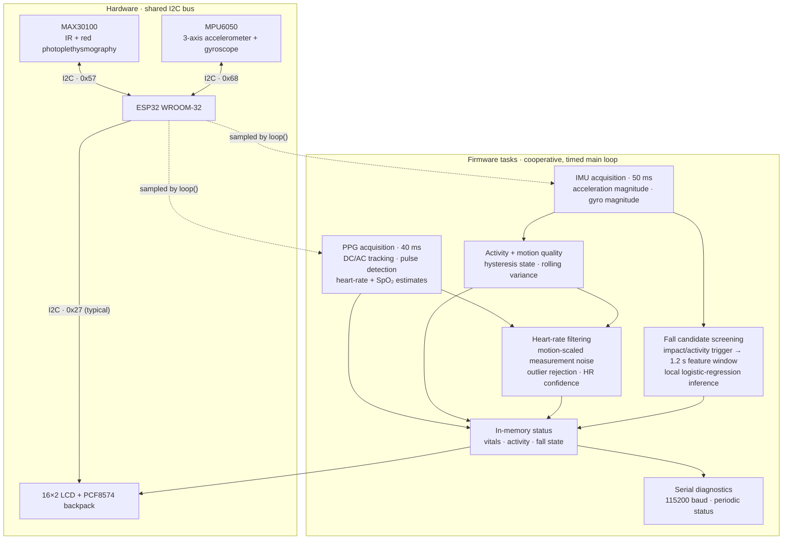

# SecureVitals Architecture

## Scope

SecureVitals is an ESP32 WROOM-32 wearable-monitoring prototype. The current firmware acquires pulse-oximeter and inertial measurements, derives heart-rate and SpO₂ estimates, screens for possible falls, and reports status locally. Sensor acquisition, signal processing, classification, and presentation all run on the ESP32.

This document describes the implementation in [`SecureVitals_v5_ML_Prototype_f.ino`](../SecureVitals_v5_ML_Prototype_f.ino), not every element in the supplied conceptual flowchart. The current firmware does not include a DS18B20 temperature sensor, persistent event logging, Wi-Fi/BLE transport, a cloud service, caregiver feedback, or a multi-level risk-scoring workflow.

## System diagram

The loop is non-blocking for routine acquisition: it schedules work using `millis()` intervals rather than waiting synchronously for each sampling period. I2C sensor operations and LCD updates remain synchronous transactions on the microcontroller.

## Hardware and interfaces

| Component | Role | Interface / configured address |
| --- | --- | --- |
| ESP32 WROOM-32 | Sensor acquisition, signal processing, fall screening, and output control | I2C SDA GPIO 21, SCL GPIO 22 |
| MAX30100 | Red/IR PPG samples for pulse and SpO₂ estimation | I2C `0x57`; firmware reads its FIFO |
| MPU6050 | Three-axis acceleration and gyroscope measurements | I2C `0x68`; accelerometer configured for ±2 g and gyroscope for ±250 dps |
| 16×2 LCD with PCF8574 backpack | Rotating local status and fall warning | I2C `0x27` by default; some backpacks use `0x3F` |
| Serial console | Diagnostics and periodic readings | 115200 baud |

The sensor and display share the same I2C bus, initialized at 100 kHz. At startup, the firmware scans the bus and initializes each device independently. Sampling is enabled only for devices whose initialization succeeded; a failed read skips that sample. The firmware reports component readiness and warnings over Serial.

## Processing and decision flow

### PPG and vital estimates

The loop attempts to read MAX30100 data every 40 ms. The red and IR channels are separated into slowly tracked DC levels and AC components; the IR AC signal is smoothed and used for adaptive-threshold pulse-crossing detection. Valid beat intervals (333–1500 ms) produce beat-rate measurements constrained to 40–180 BPM. A rolling interval buffer also supplies a raw moving-average heart-rate value.

SpO₂ is calculated when the tracked signals are usable, using the ratio of red and IR AC/DC components and a generic linear approximation. The estimate is bounded to 70–100% and smoothed. This is an uncalibrated prototype estimate, not a medical measurement.

### Motion, activity, and heart-rate confidence

The MPU6050 is sampled every 50 ms. The firmware converts raw accelerometer and gyroscope readings to physical units, then computes acceleration magnitude (`svm`) and a rolling acceleration variance. Activity uses a smoothed acceleration magnitude with separate enter/exit thresholds (1.15 g and 1.05 g) to reduce state flicker.

The heart-rate Kalman filter accepts valid beat-rate measurements, rejects extreme innovations (over 35 BPM), and increases measurement noise as motion variance rises. The firmware also marks heart rate as low-confidence when acceleration variance exceeds its configured trust limit. The filter's separate trend value is diagnostic and does not drive heart-rate prediction.

### Fall screening

Fall screening uses MPU6050-derived features only; PPG/SpO₂ values are not classifier inputs. The firmware maintains acceleration and gyroscope features, including mean acceleration, variance, peak acceleration, peak jerk, peak gyro magnitude, and minimum post-impact acceleration.

A strong impact (at least 2.8 g) starts an analysis window immediately. Otherwise, strong movement (at least 2.2 g) while activity is detected can start the window. After the 1.2-second post-impact window, the firmware supplies the six features to the local model and applies both:

1. A motion gate: peak acceleration is at least 2.0 g **or** peak gyro magnitude is at least 70 dps.
2. A classifier threshold: predicted fall probability is at least 0.85.

Only when both checks pass does the firmware set the confirmed-fall state and immediately override the LCD with a warning. A candidate that does not pass is cleared without a fall confirmation. An optional older rule-based fallback exists in the source but is disabled by default.

The sketch includes `securevitals_fall_model_prototype.h`, which defines the feature count and probability function. That generated header is not present in this repository snapshot, so it must be supplied for a successful firmware build. The model is described in the source as trained on synthetic data anchored to real readings and is not clinically validated.

## Outputs and state

- **LCD:** rotates through heart rate/SpO₂, fall/activity, acceleration/variance, and ML status screens approximately every 1.5 seconds. A confirmed fall immediately replaces the current screen with a warning.
- **Serial:** starts at 115200 baud and emits sensor readiness, measurements, confidence, activity, and fall diagnostics approximately once per second.
- **Event lifecycle:** fall and impact indicators are volatile in-memory state and are cleared after roughly three seconds. No data is persisted or transmitted by this firmware.

## Repository implementation boundary

The firmware is a standalone edge prototype, not a client/server application. There is no network transport, phone application, cloud backend, database, external alerting service, or remote confirmation path in the current implementation. The README's architecture diagram and this document intentionally describe only implemented components; future connectivity or sensors should be added to the diagram when implemented.

## Safety and limitations

- This prototype is not a certified medical device and must not be used for diagnosis, treatment, or guaranteed emergency response.
- Motion artifacts, sensor placement, device variation, and the uncalibrated SpO₂ approximation can make readings inaccurate.
- The fall classifier is experimental, depends on a generated model header not included in the repository snapshot, and has not been clinically validated.
- LCD and Serial are local indicators only. The firmware does not automatically contact a caregiver or emergency service.
